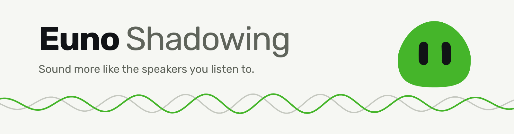
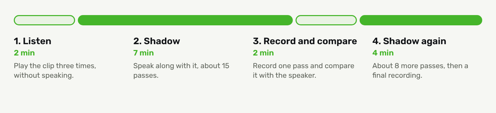

<div align="center">

<picture>
  <source media="(prefers-color-scheme: dark)" srcset="docs/img/banner-dark.png">
  
</picture>

**Daily shadowing practice with your own video clips. Free and open source.**

[**shadowing.euno.cc**](https://shadowing.euno.cc) · [Guides](https://shadowing.euno.cc/guides/) · [Spec](docs/SPEC.md) · [Architecture](docs/ARCHITECTURE.md)

[](LICENSE)
[](docs/ARCHITECTURE.md)
[](https://shadowing.euno.cc)

</div>

## What it is

Shadowing means repeating a speaker a fraction of a second behind them, copying their rhythm, melody and sounds as you go. Euno Shadowing turns that into a fifteen-minute daily routine. You choose a speaker you want to sound like, cut short clips from videos you pick, shadow them in a guided session, and compare each recording with the speaker's own audio.

Everything is free. There is no subscription, and no paid plan behind it. The only optional cost is [Ask Euno](#ask-euno-with-your-own-ai-key), which uses an AI key you bring yourself.

## A session

One session a day, on one clip of a sentence or two.

<picture>
  <source media="(prefers-color-scheme: dark)" srcset="docs/img/session-dark.png">
  
</picture>

A bad-day mode cuts it to five minutes.

## What you get

**Your own clips.** Add a video by direct `.mp4` link and mark clips on a scrubber or a zoomed waveform editor. Speed changes keep the pitch. Clips can loop, and the editor warns if a cut lands in the middle of a word.

**A guided routine.** The session has a pass counter, timer, pause and repeat. Today, Library and Progress keep everything in one place, with a streak that allows one rest day.

**A recording of every pass.** Replay the original, yours, one after the other, or both together. Euno finds the lag between you and the speaker and shows both pitch lines relative to each voice's own average.

**Sound differences, in English.** After a pass, the Pronunciation tab marks up to three places where your sounds differ from the speaker's. It compares your recording with the speaker's audio, never with a transcript, and it gives no score. A model of about 71 MB downloads once and runs in your browser. It is a beta, off by default, and it can be wrong. Over time it keeps a history of which differences keep coming back and which have gone quiet ([details](docs/PRONUNCIATION.md)).

**Timing, pitch and stress.** These comparisons work in every supported language.

**Check-ins.** At weeks 0, 4, 8 and 12 you read fixed sentences, retell something for a minute and answer an unseen question. Recordings are never overwritten, so you can hear how far you have come. You can export a blind listener pack, with shuffled recordings and a rating sheet, for someone else to rate.

### Ask Euno, with your own AI key

Ask Euno is a chat about your own practice. It also writes feedback on the notes you take about what sounded off. It uses your own Anthropic, OpenAI or OpenRouter key, which the server stores encrypted. You choose the model. Without a key, the app gives you the prompt to copy into any AI chat. Euno never needs an AI key to work.

### Connect Claude, ChatGPT or Gemini

Each user has a private [MCP server](docs/MCP.md) at `https://shadowing.euno.cc/mcp`. After an OAuth sign-in, an AI app can read your practice data, such as progress over time, notes, issues and the sound history per clip. It can also save or forget short facts about you, like your level and goals. It can't read your keys or your recordings.

## Languages

| | |
|-|-|
| **Target accents** | English (General American, Southern British, General Australian), French (Parisian, Québécois), Spanish (Mexican, Peninsular, Rioplatense) |
| **Interface** | English, French, Spanish. The French and Spanish text is machine-written and has not yet had a native read. |
| **Sound comparison** | English only. French and Spanish get timing, pitch and stress. |

More target languages are planned. The check-in material and AI prompts are organised per language in [`src/js/15-profile.js`](src/js/15-profile.js).

## Your data

- **Practice records** (clips, sessions, notes, check-ins) sit in a database on Cloudflare D1, separate for each user. Every query is scoped to the signed-in user.
- **Videos and recordings** stay on your device and, if you connect it, in your own Google Drive under the `drive.file` scope. The server never stores them.
- **Sound analysis** runs in your browser. Nothing is sent anywhere for it.
- **AI keys and Drive tokens** are sealed with a server-side secret. You can delete your account and all your data from the app.
- Sign-in is Google only. The app asks for nothing beyond that and, optionally, Drive access.

The [privacy page](https://shadowing.euno.cc/privacy/) has the full version.

## Run it locally

```sh
npm install
npx wrangler d1 migrations apply shadowing --local
printf 'DEV_NO_AUTH=1\nKEY_ENCRYPTION_KEY=%s\n' "$(openssl rand -base64 32)" > .dev.vars
npm run dev        # http://localhost:8788
```

`DEV_NO_AUTH` signs you in as `dev@localhost` and works only on localhost. After any change in `src/`, run `npm run build` and commit `dist/`, since the content-security-policy hashes are generated there.

Tests are `npm run test:*`, listed in [`package.json`](package.json). `npm run test:layout` checks the layout at many window sizes with classic scrollbars, and it runs in CI.

To deploy your own copy to Cloudflare, with Google sign-in, D1 and the reminders Worker, follow [docs/ARCHITECTURE.md](docs/ARCHITECTURE.md#setting-it-up).

## Documentation

| | |
|-|-|
| [SPEC.md](docs/SPEC.md) | What the app does and why |
| [ARCHITECTURE.md](docs/ARCHITECTURE.md) | Hosting, API, setup and code map |
| [PRONUNCIATION.md](docs/PRONUNCIATION.md) | How sound differences are found, saved and tallied |
| [MCP.md](docs/MCP.md) | The MCP server and its tools |
| [STORAGE.md](docs/STORAGE.md) | Device storage and Google Drive |
| [ACCOUNTS.md](docs/ACCOUNTS.md) | Sign-in, admin and invites |
| [PUSH.md](docs/PUSH.md) | Practice reminders |

## Licence

Euno Shadowing is open source under the [GNU Affero General Public License v3.0](LICENSE).

Euno's animation engine in [`src/euno/engine/`](src/euno/engine) comes from the [Bible Strong avatar lab](https://github.com/smontlouis/bible-strong-avatar-lab) by Stéphane Montlouis-Calixte, also AGPL-3.0, which is why the whole app uses that licence. Models, libraries and fonts keep their own licences, listed in [THIRD-PARTY-NOTICES.md](THIRD-PARTY-NOTICES.md).
