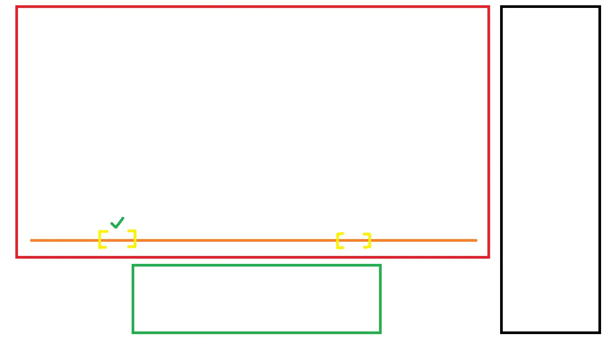

# Shadowing Practice App — Feature Spec

Oct 10, 2026 · @Adrien JALLA

## Purpose

Build a personal web app for daily shadowing practice that helps Adrien move his English accent towards General Australian English. It must run as a published Claude artifact, so the built-in AI feedback uses his Claude plan with no API key.

* **User:** Adrien, 18, French-Australian. Native-level English comprehension and a good ear for his own errors; only started speaking English regularly at 17.5. His accent is mainly in rhythm, stress and melody rather than individual words.
* **Model speaker:** Oscar Piastri interviews, plus other General Australian speakers later.
* **Single user.** No accounts, sharing or multi-user features needed.
* **Interface language:** English, Australian spelling (centre, colour, practise as a verb).
* **Principle:** every default that research has not settled (clip length, pass counts, session length) must be a setting, not hard-coded.

## The practice routine

The app exists to run one 15-minute session a day, 6 days a week. Each session works on one clip of 1–2 sentences (10–20 seconds by default).

1. **Listen (2 min):** play the clip 3 times without speaking.
2. **Shadow (7 min):** speak along with the clip at the same time, no transcript, about 15 passes.
3. **Record and compare (2 min):** record one pass and compare it with the original. Nothing to pick; this checks how close the repetition is getting.
4. **Shadow again (4 min):** about 8 more passes, copying everything as closely as possible, then record a final pass and compare it with the step 3 recording.

**Bad-day mode:** a 5-minute version (steps 1–2 with 5 passes). The app should nudge towards never skipping two days in a row.

**Copy everything, target only what sticks:** every pass aims to copy the speaker as closely as possible (rhythm, melody and sounds together). If the same difference is still there after several days, Adrien targets that one thing in step 4. There is no weekly focus schedule; the issues list (see notes section) shows which problems keep coming back.

**Clip rotation (suggested, not enforced):** a new clip Mon, Wed and Fri; repeat the previous day's clip Tue, Thu and Sat.

All step durations and pass counts above are defaults and must be adjustable in settings.

## Layout

One main screen with three areas, matching Adrien's mockup (attach it when handing this spec over):

* **Video player (left, large):** the video with custom controls and a scrubber along its bottom edge. Clip brackets sit on the scrubber.
* **Videos sidebar (right, tall):** the video library.
* **Analysis panel (below the player):** pitch / waveform view while shadowing; zoomed clip editor while cutting a clip.

The guided session controls (current step, passes done and remaining, timer) need a clear place near the player. On phone width the sidebar collapses into a drawer and the panel stacks under the player.

## Video library

Videos are added by direct link to an MP4 file (for example `https://pomf2.lain.la/f/oy4efu9g.mp4`). The app never stores the video file itself.

* **Add video:** URL + title. Check the link actually plays and show a clear error if not (share pages from Google Drive, MEGA etc. will fail).
* **Per video:** open (load in the player), open original link, edit title, edit link, archive.
* **Archive, never delete:** archived videos move to a collapsible Archived section and can be restored. Their clips and history are kept.
* **List item shows:** title and progress (clips done / total clips, last practised date).
* **Optional later:** a speaker field (Piastri or another Australian), to support practising with several voices.

## Player, scrubber and clip brackets

The player uses custom controls on top of a normal video element; a fully custom player is not needed.

* **Controls:** play/pause, speed (0.5x, 0.75x, 1x, with pitch preserved), loop current clip on/off, volume.
* **Scrubber:** each saved clip appears as a bracket `[   ]` at its position. A clip marked done shows a tick above its bracket. Clicking a bracket selects that clip and jumps to it.
* **Selected clip:** highlighted bracket; looping plays from clip start to clip end and jumps back automatically.
* **Known problem:** on a long video a 10–20 second clip is a tiny sliver of the scrubber. The scrubber is for finding your place and seeing clips; precise cutting happens in the zoomed editor (next section).
* **Keyboard shortcuts:** space = play/pause, a key to replay the loop, keys to mark clip start and end, keys to change speed. Show them in a small help overlay.

## Making clips

A clip is a start and end time inside a video, cut so it starts and ends on a pause in speech. It does not need frame precision.

1. **Rough selection:** drag on the scrubber, or press the start/end keys while the video plays.
2. **Fine adjustment:** the analysis panel switches to a zoomed waveform of the selection (with a little margin either side), so gaps where the speaker stops are visible. Drag the clip edges onto those gaps. Nudge buttons move each edge by ±0.1 s.
3. **Length indicator:** shows the clip length in seconds, coloured green inside the target range (default 10–20 s), amber just outside it, red when far outside. The range is a setting.
4. **Save:** optional label (e.g. a few words of what's said). Then either **Shadow now** (starts the guided session on this clip) or keep making more clips.
* Several clips can be selected and queued; the session works through the queue in order.
* Clips can be edited (move edges, relabel) or archived later.
* A clip must never cut a sentence in half; if the edges land mid-word, warn.

## Guided shadowing session

The session walks Adrien through the four steps of the routine on the selected clip, so he never has to count or keep time himself.

* **Step bar:** Listen → Shadow → Record & compare → Shadow again, with the current step highlighted and a progress bar.
* **Pass counter per step:** passes done and passes remaining (e.g. "Shadow: 9 / 15"). The clip loops automatically and each loop counts as a pass. A short gap between loops (default about 1 s, a setting).
* **Session timer:** counts towards 15 minutes; shows time left.
* **Controls:** pause, repeat a pass, skip a step, end session early (progress still saved).
* **Bad-day button:** switches to the 5-minute version.
* **Clip done:** after a complete session the clip gets its tick. A clip can be practised again any time.
* **Shorten hint:** if Adrien flags he can't keep up after about 5 shadow passes, suggest shortening the clip.
* **Review (optional setting):** a finished clip can come back 1–2 days later for a shorter run. Off by default.

## Recording and comparing

Pressing play on a recording pass starts the microphone at the same moment as the clip, so Adrien shadows while being recorded.

* **Headphones:** show a reminder to use headphones (wired ideally), otherwise the mic picks up the clip audio.
* **Playback options after a pass:** original only, my recording only, original then mine, both together.
* **Recordings kept:** at least the step 3 recording and the final recording of each session, so progress on a clip can be heard over weeks. Older pass recordings can be discarded.
* **Compare view:** the step 3 and final recordings side by side for that session.
* **History per clip:** list of past sessions with their saved recordings, newest first.

## Pitch and waveform panel

The panel shows Adrien's voice against the model's so he can see where his rhythm and melody differ. **Pitch is the default view**, with a toggle to waveform (loudness over time).

* **Model line worked out once:** the model clip's pitch line and waveform are calculated when the clip is saved and stored, so they appear instantly later.
* **Live:** while Adrien speaks, his pitch line draws in real time next to the model's.
* **Two lanes, not overlaid:** model on top, Adrien below, same time axis, so lines that differ a lot stay readable.
* **Compare shapes, not heights:** each voice is shown relative to that speaker's own average pitch, because their voices sit at different heights.
* **Waveform view:** shows timing — where words start, pauses, which syllables are louder.

### Syncing the two lines

Adrien always trails the model slightly, and the mic adds its own delay, so the lines need lining up.

1. **Live:** detect the moment Adrien starts speaking and line his line up from there (rough).
2. **After each pass:** compare the loudness patterns of both recordings, slide Adrien's until they match best, and redraw. This is the accurate one.
3. **Fallback:** a manual offset setting, remembered, for when auto-alignment fails.
* **Show the lag:** display how far behind Adrien was on each pass (e.g. "0.3 s behind") and log it. A shrinking lag over weeks counts as progress. Handle negative lag (speaking ahead).
* **Noisy clips:** interview audio with engines or crowds can make the pitch line jump. Smooth it, hide unreliable stretches, and let Adrien flag a clip as too noisy.

## "What sounded off" notes and AI feedback

Adrien can hear his own errors, so after a recorded pass he types what sounded wrong and gets suggestions from Claude inside the app.

* **Note box on each recorded pass:** free text, e.g. "the vowel in 'go' sounds too pure, doesn't glide" or "stressed the last syllable of 'comfortable'". Optional fields: the sentence being practised, and what he was aiming for (e.g. "the vowel in 'bird'").
* **Ask Claude:** sends the sentence and the note to Claude, using the artifact's built-in Claude access (counts against Adrien's plan, no API key). Claude replies with what the likely Australian English feature is, what to change, and what to listen for in the model clip. Text only; no audio is sent.
* **Instruction to Claude in the request:** Adrien is a French-Australian heritage speaker targeting General Australian English; answer in Australian spelling, plainly, no jargon; say "I don't know" if the description is too ambiguous and ask what he meant.
* **Saved:** each note and reply is stored with the pass and clip.
* **Issues list:** a running list of recurring problems pulled from the notes (Adrien can tick, merge or rename them). It shows which problems to work on next.

## Progress tracking and check-ins

The app must show whether practice is actually changing Adrien's speech, not just that he practised.

**Habit tracking**

* Streak, sessions this week against a target of 6, total minutes.
* Calendar view of practised days, with bad-day sessions marked differently.
* The "don't skip two days in a row" nudge.

**Check-ins (weeks 0, 4, 8 and 12)**

* Week 0 is the baseline and must be recorded before the first practice session; the app should prompt for it on first launch.
* Each check-in records three things: a fixed set of read-aloud sentences (same every time), a 60-second retelling of something he watched, and a 60-second answer to a question he hasn't seen. The app supplies a random unseen question from a built-in list.
* Check-in recordings are never overwritten.
* **Compare view:** play any check-in against the baseline.

**Objective measures (best effort, against the model clips)**

* Speaking rate (syllables per second).
* Length of stressed vs unstressed syllables.
* Pitch range (in semitones).
* Average lag behind the model.
* Shown as simple trends over the weeks. Label them clearly as rough measures, not an accent score.

**Blind listener pack**

* Export a shuffled, unlabelled set of check-in clips plus one or two real Australian clips, with a simple rating sheet (1 = no foreign accent, 9 = very strong accent, plus "what gave it away?").
* Let Adrien enter ratings back in, and show the average per check-in.

## Data to store

Everything below must persist across sessions and devices, in the artifact's database rather than browser storage. Recordings go in the artifact's file storage if available.

|What|Contents|
|-|-|
|Videos|title, URL, speaker (optional), archived yes/no, date added|
|Clips|video, start, end, label, done yes/no, archived yes/no, stored model pitch line and waveform, noisy flag|
|Sessions|date, clip, mode (full or bad-day), steps completed, minutes|
|Passes|session, step, pass number, lag, recorded yes/no|
|Recordings|session, pass, file reference (step 3 and final passes; all check-ins)|
|Notes|pass, sentence, what sounded off, aiming for, Claude's reply|
|Issues|name, linked notes, status|
|Check-ins|week number, three recordings, objective measures, listener ratings|
|Settings|clip length range, step durations, pass counts, loop gap, sync offset, review on/off, programme start date|

## Look and feel

The app should feel like Duolingo: friendly, bright and motivating, so a 15-minute daily session feels like a game rather than a chore.

* Rounded shapes, chunky buttons, bold green as the main colour, clear progress bars.
* Small celebrations when a clip is finished, a streak grows, or a check-in is done.
* Duolingo-inspired only: no owl, logo or Duolingo branding.
* Light and dark mode.
* Calm during the shadowing step itself: minimal movement on screen while he is speaking, so it doesn't distract.

## Risks to test first and build order

Several features depend on things that may not work in an artifact or with these video links. Test each one with a tiny prototype before building on it, and report clearly which ones fail.

**Test first**

* Microphone access inside a published artifact.
* Whether pomf.lain.la lets the page read the video's audio (needed for pitch and waveform; playback and looping work regardless). If not, find a fallback, such as letting Adrien upload a short clip file.
* Storing recordings: size limits and whether file storage is available on his account.
* Calling Claude from inside the artifact (especially if the artifact is published from Claude Code).
* Pitch tracking quality on real interview audio with background noise.
* Auto-alignment accuracy on real passes.

**Build order** (each stage must be usable on its own)

1. Video library, clips, scrubber brackets, looping, guided session, practice log, streak.
2. Recording and playback comparison.
3. Waveform and pitch display, model lines stored per clip.
4. Live pitch with start detection, then after-pass alignment and lag.
5. Notes and Claude feedback, issues list.
6. Check-ins, objective measures, blind listener pack.

Stage 1 alone covers the daily routine, so Adrien can start practising while later stages are built.

## Out of scope and open decisions

**Out of scope**

* Automatic accent scoring or "how Australian do you sound" ratings.
* Downloading from YouTube or playing MEGA / Google Drive share links.
* Transcripts (not needed; Adrien's comprehension is native-level).
* Accounts, sharing, or multiple users.

**Open decisions (defaults chosen, change if needed)**

* **When a clip counts as done:** a clip gets its tick after one complete guided shadowing session (listen, shadow, record and compare, shadow again). Alternative: only after its review run.
* **Review runs (off by default):** a finished clip comes back 1–2 days later for a shorter session (listen once, about 5 shadow passes, one recording) to check the fix stuck. Untested for shadowing. The suggested clip rotation already repeats each clip the next day, so this may be redundant.
* **Baseline before the app can record:** the week-0 baseline must be recorded before any practice. Recording only arrives in stage 2, so if practice starts on stage 1, record the baseline on a phone and import it later. Better: include a basic baseline recorder in stage 2.
